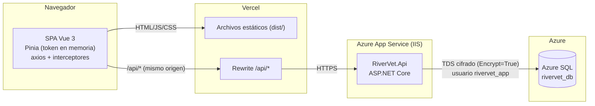
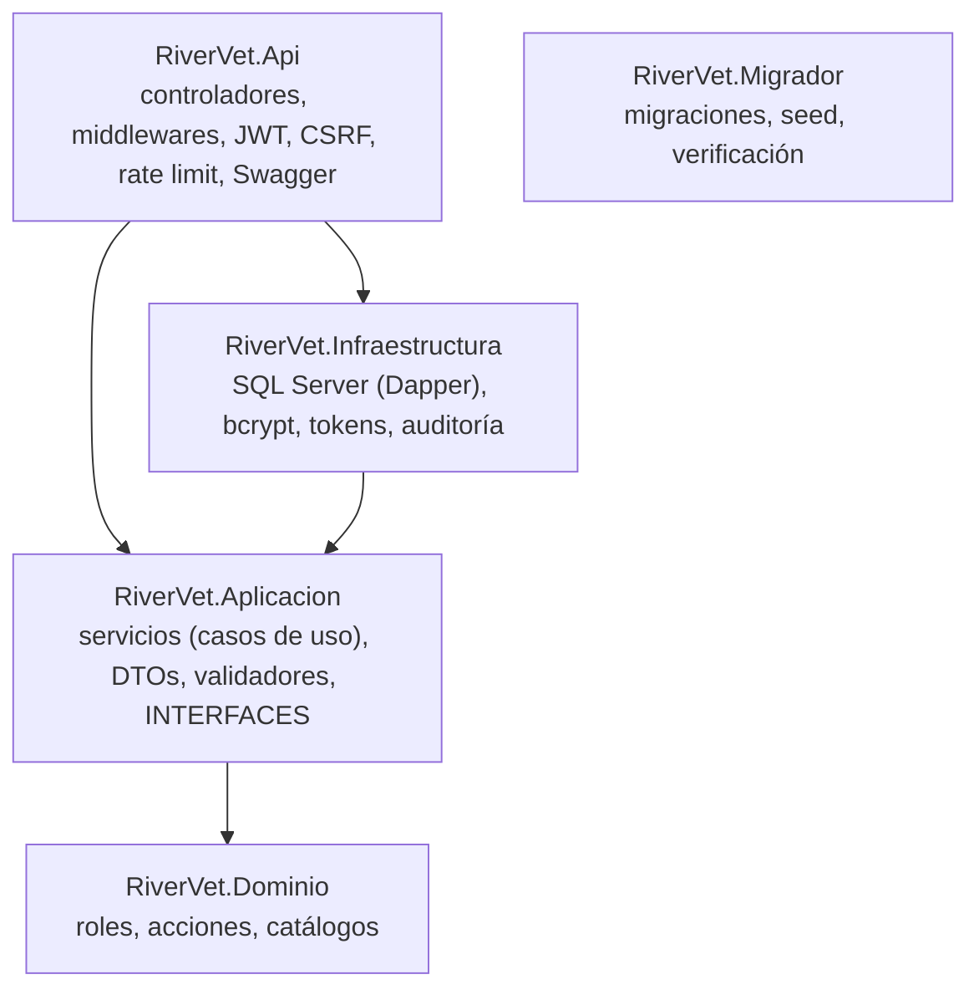

# Arquitectura — RiverVet

## 1. Dos proyectos en un repositorio (monorepo)

| Carpeta | Contenido | Tecnología | Despliegue |
|---|---|---|---|
| `backend/` | API REST + base de datos (migraciones, seed) | ASP.NET Core Web API (.NET 10) | IIS (Azure App Service Windows) + Azure SQL |
| `frontend/` | SPA | Vue 3 + Vite | Vercel |

Los dos viven en el repositorio `rivervet`, pero son **independientes**: cada uno
tiene su propia CI y su propio CD (en `.github/workflows/` de la raíz), y lo único
compartido es el **contrato**: [`API.md`](API.md).

```
rivervet/
├── .github/
│   ├── workflows/            ← backend-ci · backend-cd · frontend-ci · frontend-cd
│   ├── dependabot.yml        ← NuGet (backend/), npm (frontend/) y GitHub Actions
│   └── pull_request_template.md
├── backend/                  ← ver §4
└── frontend/                 ← ver §6
```

## 2. Diagrama de componentes



En desarrollo se reproduce igual: Vite (`localhost:5173`) hace de proxy de `/api`
hacia IIS Express (`localhost:3000`).

## 3. Capas del backend



Regla de dependencias: **Aplicación define las interfaces** (`IUsuariosRepositorio`,
`IHasheadorPassword`, `IServicioTokens`...) e **Infraestructura las implementa**.
La lógica de negocio no depende de SQL Server ni de ASP.NET: se puede probar y
cambiar la tecnología sin reescribir las reglas.

### Recorrido de una petición

```
Petición HTTP
 → TrazaMiddleware          (traceId + log de la petición)
 → ManejadorErroresMiddleware (convierte excepciones en { success:false, ... })
 → CabecerasSeguridadMiddleware (CSP, X-Frame-Options, nosniff...)
 → CORS → Rate limiter → Autenticación JWT (relee usuario de la BD) → Autorización por rol
 → Controlador → FiltroValidacion (normaliza + FluentValidation, 422 si falla)
 → Servicio (reglas de negocio, transacción, auditoría)
 → Repositorio (SQL parametrizado, control de propiedad en el WHERE)
 → SQL Server
```

## 4. Árbol del backend

```
backend/
├── RiverVet.slnx                 ← se abre en Visual Studio
├── configurar-desarrollo.ps1     ← deja todo listo en una PC nueva
├── Directory.Build.props         ← .NET 10, analizadores como errores, auditoría NuGet
├── .editorconfig                 ← estilo + reglas de seguridad (CA2100, CA5350...)
├── database/
│   ├── migraciones/              ← 0001..0004 — INMUTABLES una vez aplicadas
│   ├── seed/datos_desarrollo.sql
│   ├── local/                    ← 01_crear_bd_y_usuarios.sql · 02_permisos_app.sql
│   └── azure/                    ← crear_usuarios_azure.sql
├── docs/                         ← API · MODELO_DATOS · ARQUITECTURA · INSTALACION · INTEGRACION_LOCAL · CI · DESPLIEGUE · SEGURIDAD · CICD
├── herramientas/                 ← simular-webhook.ps1 (aviso firmado de la pasarela simulada)
├── src/
│   ├── RiverVet.Api/
│   │   ├── Program.cs            ← arma todo el pipeline
│   │   ├── Properties/launchSettings.json   ← perfiles "IIS Express" y "http"
│   │   ├── web.config            ← IIS: sin cabeceras Server / X-Powered-By
│   │   ├── appsettings.json      ← configuración SIN secretos
│   │   ├── Controllers/          ← Auth, Usuarios, Clientes, Mascotas, Auditoria, Salud, Citas, Atencion,
│   │   │                           Productos, Ventas (carrito, pedidos, indicadores), Pagos (+ webhook), Triage
│   │   ├── Middlewares/          ← Traza, ManejadorErrores, CabecerasSeguridad
│   │   ├── Seguridad/            ← EventosJwt, CookiesSesion, ValidarCsrf, ContextoPeticion
│   │   ├── Filtros/              ← FiltroValidacion
│   │   ├── Configuracion/        ← ValidadorConfiguracion (fail-fast), Swagger
│   │   ├── Respuestas/           ← RespuestaApi, RespuestaError, errores de model binding
│   │   ├── Registro/             ← RedactorLogEnricher (Serilog)
│   │   └── Json/                 ← ConvertidorFechaUtc
│   ├── RiverVet.Aplicacion/
│   │   ├── Abstracciones/        ← interfaces: unidad de trabajo, tokens, auditoría...
│   │   ├── Comun/                ← excepciones, paginación, reglas de validación, redactor
│   │   ├── Autenticacion/        ← HU-001
│   │   ├── Usuarios/             ← HU-001 (alta por admin)
│   │   ├── Clientes/             ← HU-002, HU-003
│   │   ├── Mascotas/             ← HU-004, HU-005
│   │   ├── Citas/                ← HU-008, HU-009, HU-010
│   │   ├── Historial/, Vacunas/  ← HU-006, HU-007, HU-011
│   │   ├── Recordatorios/        ← HU-012
│   │   ├── Productos/            ← HU-013, HU-014
│   │   ├── Ventas/               ← HU-015, HU-016 (carrito, pedidos, stock atómico)
│   │   ├── Indicadores/          ← HU-018
│   │   ├── Pagos/                ← HU-017, HU-019 (Yape, pasarela, firma de webhooks)
│   │   ├── Comprobantes/         ← HU-020 (WhatsApp)
│   │   ├── Triage/               ← HU-021
│   │   ├── DatosPersonales/      ← Ley N° 29733 (exportación)
│   │   └── Auditoria/
│   ├── RiverVet.Dominio/         ← Roles, AccionesAuditoria, Catalogos, estados de citas, pedidos y pagos
│   ├── RiverVet.Infraestructura/
│   │   ├── Datos/                ← SesionBd (unidad de trabajo) + repositorios con Dapper
│   │   ├── Seguridad/            ← bcrypt, JWT, limitador de login, auditoría
│   │   └── Externos/             ← pasarela de pagos (simulada) y WhatsApp (enlace o API Cloud)
│   └── RiverVet.Migrador/        ← herramienta de consola de base de datos
└── tests/RiverVet.Pruebas/
    ├── Unitarias/                ← sin base de datos
    └── Integracion/              ← API completa contra SQL Server real (rivervet_test)
```

Cada módulo de Aplicación sigue la misma forma: `*Modelos.cs` (DTOs + validadores
+ interfaz del repositorio) y `*Servicio.cs` (reglas de negocio). El controlador
solo traduce HTTP ↔ servicio; el repositorio solo ejecuta SQL.

## 5. Tecnologías del backend

| Necesidad | Elección | Por qué |
|---|---|---|
| Framework | ASP.NET Core Web API (.NET 10 LTS) | Hospedaje en IIS / IIS Express, Swagger, alto rendimiento |
| Acceso a datos | **Dapper** + `Microsoft.Data.SqlClient` | SQL escrito a mano y parametrizado (sin ORM, como pide el proyecto) |
| Validación | FluentValidation | Reglas declarativas y mensajes en español |
| Contraseñas | bcrypt (BCrypt.Net-Next, costo 12) | Estándar probado; lento a propósito |
| Tokens | JWT HS256 (`Microsoft.AspNetCore.Authentication.JwtBearer`) | Algoritmo fijado explícitamente |
| Logs | Serilog (consola + archivo diario) | Con redacción de datos sensibles |
| Límite de solicitudes | `Microsoft.AspNetCore.RateLimiting` | Incluido en ASP.NET Core |
| Documentación viva | Swagger (Swashbuckle) | Solo en desarrollo |
| Pruebas | xUnit + Shouldly + `WebApplicationFactory` + coverlet | Integración contra SQL Server real |

## 6. Árbol del frontend

```
frontend/
├── src/
│   ├── main.js                   ← crea la app y conecta axios con el store
│   ├── router/                   ← rutas con roles + guard global
│   ├── stores/                   ← auth (token en memoria) · notificaciones
│   ├── services/http.js          ← axios: token, 401 → refresh encolado, CSRF
│   ├── services/api/             ← una función por endpoint de API.md
│   ├── composables/              ← usePeticion · useConfirmacion · useInactividad
│   ├── components/base/          ← Button, Input, Select, Modal, TablaPaginada, Alert...
│   ├── layouts/AppLayout.vue     ← menú por rol, cierre por inactividad
│   ├── utils/                    ← validaciones (espejo del backend), errores, formato
│   └── views/                    ← *View.vue por pantalla
├── tests/                        ← Vitest
├── vercel.json                   ← rewrite /api + cabeceras de seguridad (CSP)
└── vite.config.js                ← proxy de desarrollo /api → localhost:3000
```

## 7. Decisiones importantes

| Decisión | Por qué |
|---|---|
| Backend y frontend separados | Dos personas en paralelo; cada capa con su CI y su despliegue |
| ASP.NET Core + IIS | Se abre y ejecuta desde Visual Studio (IIS Express) y se publica igual en IIS |
| Proxy `/api` (Vite en local, rewrite de Vercel en producción) | Mismo origen → cookies `SameSite=Strict`, CSRF legible, cero CORS en el navegador |
| Access token en memoria + refresh en cookie HttpOnly | Un XSS no puede robar el refresh token; al recargar se recupera la sesión |
| Rotación de refresh token con familias | Detecta tokens robados y cierra la sesión comprometida |
| Rol releído de la base en cada petición | Desactivar a alguien o cambiarle el rol surte efecto de inmediato |
| Control de propiedad en el SQL | Imposible olvidarlo en un controlador; un recurso ajeno da 404 |
| Todo endpoint exige sesión por defecto | Política *fallback*: hay que marcar `[AllowAnonymous]` a propósito |
| Búsquedas por POST | Los DNI y nombres no quedan en URLs ni en logs |
| Restricciones únicas y CHECK en la base | Doble agendamiento y stock negativo imposibles aun con errores de código |
| Usuario de BD sin DELETE ni DDL | Limita el daño de una inyección SQL |
| Secretos en User Secrets / variables de entorno | Nunca en el repositorio; la API no arranca si faltan |
| Analizadores como errores de compilación | Una advertencia de seguridad (p. ej. SQL concatenado) rompe el build |
