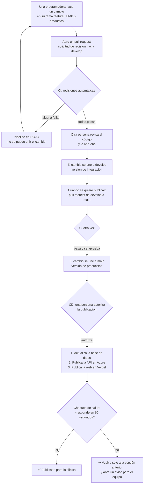

# CI/CD de RiverVet, explicado sin tecnicismos

> **Para quién es este documento:** para quien necesite entender cómo se prueba y se publica RiverVet sin ser programador (docentes, evaluadores, la administración de la clínica). Los detalles técnicos están en [CI.md](CI.md) y [DESPLIEGUE.md](DESPLIEGUE.md).

---

## 1. La idea en una frase

**Ningún cambio llega a la clínica sin que una batería de revisiones automáticas lo apruebe primero, y sin que una persona autorice la publicación. Si algo sale mal al publicar, el sistema vuelve solo a la versión anterior.**

Hace el trabajo de un control de calidad en una fábrica. Cada pieza nueva pasa por varias estaciones de inspección y, si falla en una, no sale de la fábrica.

- **CI** (*Integración Continua*): las inspecciones automáticas que se hacen **cada vez** que alguien propone un cambio.
- **CD** (*Despliegue Continuo*): la publicación automática en internet, **solo** de lo que aprobó la CI y autorizó una persona.

Todo esto corre gratis en **GitHub Actions**, un servicio de GitHub que ejecuta estas tareas en computadoras en la nube.

---

## 2. El recorrido completo de un cambio

---

## 3. Las ramas: tres "copias" del proyecto

| Rama | Qué es | Quién la toca |
|---|---|---|
| `main` | Lo que usa la clínica (**producción**) | Nadie directamente: solo con un pull request aprobado |
| `develop` | Donde se juntan los cambios terminados (**integración**) | Nadie directamente: solo con un pull request aprobado |
| `feature/HU-xxx-...` | Una rama por historia de usuario, p. ej. `feature/HU-016-confirmar-pedido` | La persona que la desarrolla |

GitHub está configurado para **impedir** que alguien suba cambios directo a `main` o `develop`: exige que la CI esté en verde y que otra persona apruebe (ver [CI.md §3](CI.md)).

---

## 4. Qué revisa la CI (en cada cambio)

El repositorio tiene dos proyectos, cada uno con su propia CI: la **API** (carpeta `backend/`) y la **página web** (carpeta `frontend/`). Cada CI tiene varias "estaciones" que corren **al mismo tiempo** para terminar antes.

### 4.1 API — [`.github/workflows/backend-ci.yml`](../../.github/workflows/backend-ci.yml)

| Estación | Qué hace, en palabras simples | Se pone en rojo si… |
|---|---|---|
| **backend** | 1. Revisa que el código esté ordenado con el mismo estilo. 2. Lo compila; cualquier advertencia cuenta como error. 3. Levanta una base de datos SQL Server de prueba y ejecuta **más de 250 pruebas automáticas**. Por ejemplo: "10 personas compran a la vez la última unidad: solo una puede ganar", "un cliente no puede ver las mascotas de otro", "un aviso de pago falso se rechaza". 4. Mide qué porcentaje del código recorren las pruebas (**cobertura**). | hay desorden de formato, el código no compila, alguna prueba falla, o la cobertura baja del **60 %** (hoy está en ~87 %) |
| **seguridad** | 1. Busca librerías con **vulnerabilidades conocidas**. 2. **gitleaks** busca contraseñas o claves subidas por error, en todo el historial. 3. **CodeQL** (de GitHub) analiza el código en busca de patrones inseguros. Si el repositorio es privado, este paso se omite, porque GitHub lo cobra aparte para repos privados. | aparece una librería vulnerable grave, una clave filtrada o un problema de seguridad |
| **base de datos** | Crea una base **vacía**, aplica todas las migraciones (los cambios de estructura de la base) en orden, verifica que la estructura quede correcta, y comprueba dos cosas: que aplicarlas dos veces no rompa nada, y que editar una migración ya aplicada se detecte. | una migración falla o la estructura no es la esperada |

### 4.2 Página web — [`.github/workflows/frontend-ci.yml`](../../.github/workflows/frontend-ci.yml)

| Estación | Qué hace | Se pone en rojo si… |
|---|---|---|
| **frontend** | Revisa estilo y errores comunes (ESLint y Prettier), ejecuta las pruebas automáticas (Vitest) y **compila la página** como se publicará. | hay errores de estilo, una prueba falla o la página no compila |
| **seguridad** | `npm audit` (librerías vulnerables), gitleaks y CodeQL | igual que en la API |

**¿Cuánto tarda?** Unos minutos: la estación más larga es la de pruebas, que en una PC tarda cerca de un minuto y medio. El resultado aparece como ✅ o ❌ junto al pull request.

---

## 5. Qué hace el CD (la publicación)

Solo se activa cuando un cambio llega a `main` **y** la CI de ese cambio salió en verde. Luego:

1. **Pide autorización.** GitHub se detiene y espera a que una persona responsable pulse **"Approve and deploy"**. Nada se publica sin una decisión humana.
2. **Actualiza la base de datos** en Azure SQL, aplicando solo las migraciones nuevas. Si alguien editó una migración vieja, se detiene antes de tocar nada.
3. **Publica la API** en Azure App Service (un servidor Windows con IIS).
4. **Chequeo de salud:** durante 60 segundos pregunta a la API "¿estás bien?" (`GET /api/health`). La API responde que sí solo si arrancó correctamente **y** puede hablar con la base de datos.
5. **Si no responde bien, retrocede solo:** vuelve a publicar la versión anterior, comprueba que esa sí funcione y abre un aviso (*issue*) en GitHub para el equipo.
6. La página web sigue el mismo camino en **Vercel**, con su propio chequeo de salud y su propio retroceso automático.

> **¿Por qué es seguro?** La clínica nunca queda con una versión rota: o la nueva funciona, o vuelve la anterior en minutos, sin que nadie tenga que hacer nada a mano.

---

## 6. Los secretos: dónde viven las claves

Las contraseñas y claves (de la base de datos, de Azure, de Vercel) **nunca** están en el código.

| Dónde | Qué guarda | Quién lo ve |
|---|---|---|
| **GitHub Secrets** | Las llaves para publicar: `AZURE_WEBAPP_PUBLISH_PROFILE`, `AZURE_SQL_MIGRADOR_CONNECTION_STRING`, `VERCEL_TOKEN`… | Nadie las puede volver a leer, ni el administrador: GitHub solo las usa durante la publicación y las oculta en los registros |
| **Configuración de Azure App Service** | Las claves que usa la API mientras funciona: conexión a la base, clave de sesiones (JWT), secreto de los avisos de pago… | Solo quien administra la cuenta de Azure |
| **User Secrets** (en la PC del desarrollador) | Las claves de su entorno de pruebas | Solo esa persona, en su PC |

Si una clave se filtra, [DESPLIEGUE.md §9](DESPLIEGUE.md) explica cómo cambiar cada una. Borrarla del código **no basta**: hay que invalidarla.

La lista completa y exacta de secretos, y cómo configurarlos, está en [DESPLIEGUE.md §6](DESPLIEGUE.md).

---

## 7. Configurar todo desde cero (resumen)

Los pasos detallados, con la opción exacta que hay que elegir en cada pantalla, están en [DESPLIEGUE.md](DESPLIEGUE.md). En resumen:

| Paso | Servicio | Qué se hace | Costo |
|---|---|---|---|
| 1 | **GitHub** | Crear el repositorio `rivervet`, las ramas `main` y `develop`, y activar su protección | Gratis (repo privado: la protección requiere GitHub Pro, gratis con el Student Pack) |
| 2 | **Azure SQL** | Crear la base de datos y sus dos usuarios de permisos mínimos | Gratis con Azure for Students |
| 3 | **Azure App Service** | Crear el servidor de la API (Windows + IIS) y cargarle su configuración | Plan F1 gratuito |
| 4 | **Vercel** | Crear el proyecto de la página web | Plan Hobby gratuito |
| 5 | **GitHub** | Crear el entorno `produccion` con **aprobación obligatoria** y cargar los secretos | Gratis |
| 6 | — | Hacer el primer pull request de `develop` a `main` y aprobar la publicación | — |

Además, **Dependabot** revisa cada semana si hay versiones nuevas de las librerías y abre un pull request para actualizarlas, que también pasa por toda la CI.

---

## 8. Cómo leer un pipeline en rojo

En GitHub: pestaña **Actions** → la corrida con ❌ → la estación en rojo → el paso en rojo. El mensaje de error está al final del registro.

| Si falla… | Qué significa | Qué hacer |
|---|---|---|
| **Formato** | El código no sigue el estilo acordado | Ejecutar `dotnet format` (API) o `npm run format` (web) y volver a subir |
| **Compilar** | Hay un error o una advertencia en el código, p. ej. un SQL armado concatenando texto | Leer el mensaje: indica archivo y línea |
| **Pruebas** | Algo dejó de funcionar como se esperaba | El registro dice qué prueba falló y qué esperaba vs. qué obtuvo |
| **Cobertura** | Se agregó código sin pruebas y el total bajó del 60 % | Escribir pruebas para el código nuevo |
| **Paquetes vulnerables / npm audit** | Una librería tiene una falla de seguridad conocida | Actualizarla (normalmente Dependabot ya abrió el pull request) |
| **gitleaks** | Se subió algo que parece una contraseña o clave | **Cambiar esa clave de inmediato** (considerarla filtrada) y quitarla del código |
| **CodeQL** | Patrón de código inseguro | Ver el detalle en la pestaña **Security** de GitHub |
| **Migraciones** | Un cambio de la base de datos tiene un error, o alguien editó una migración vieja | Corregir la migración nueva; las ya aplicadas **nunca** se editan: se crea una nueva |
| **CD: health check** | La versión nueva no arrancó en Azure (casi siempre falta una configuración). **Ya se volvió solo a la versión anterior** | Revisar la configuración de App Service (la API dice qué valor falta) y volver a publicar |

---

## 9. Qué evidencia deja todo esto

Útil para el informe académico:

- **Historial de Actions:** cada corrida queda registrada, con fecha, autor, resultado y registros completos.
- **Artefactos:** los resultados de las pruebas y el reporte de cobertura se pueden descargar desde cada corrida.
- **Aprobaciones:** GitHub registra quién autorizó cada publicación a producción y cuándo.
- **Pull requests:** muestran qué cambió, quién lo revisó y que la CI estaba en verde al unirlo.
- **Pestaña Security:** hallazgos de CodeQL y avisos de Dependabot.
