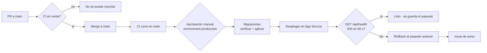

# Despliegue continuo (CD) — configuración desde cero

Arquitectura de producción:

```
Usuario ──HTTPS──► Vercel (frontend Vue)
                     │  /api/*  ── rewrite ──►  Azure App Service · Windows (IIS)  →  RiverVet.Api
                     │                                                                      │
                     └─ archivos estáticos                                   Azure SQL Database (rivervet_db)
```

| Pieza | Servicio | Plan |
|---|---|---|
| Base de datos | Azure SQL Database | oferta gratuita de Azure SQL (Azure for Students) |
| API | Azure App Service **Windows** (usa **IIS**, igual que IIS Express en tu PC) | F1 gratuito |
| Frontend | Vercel | Hobby (gratuito) |
| Pipelines | GitHub Actions | gratuito en repositorios públicos |

Workflows:

| Parte | Archivo (en la raíz del repositorio) | Qué hace |
|---|---|---|
| backend | [`.github/workflows/backend-cd.yml`](../../.github/workflows/backend-cd.yml) | migraciones en Azure SQL → despliegue en App Service → health check → rollback si falla |
| frontend | [`.github/workflows/frontend-cd.yml`](../../.github/workflows/frontend-cd.yml) | build → despliegue en Vercel → health check (incluye `/api/health` a través del rewrite) → rollback si falla |

Los dos se disparan **solo** cuando su CI terminó en verde después de un merge
a `main`, y **esperan la aprobación manual** de un revisor (environment
`produccion`).

Mientras no configures Azure y Vercel, los CD **se omiten solos**: el de backend
solo corre si existe la variable `AZURE_WEBAPP_NAME`, y el de frontend si existe
`URL_FRONTEND_PRODUCCION` (paso 6). Así el repositorio puede estar en GitHub
desde el primer día sin que cada merge termine en un despliegue fallido.

---

## 1. Azure: cuenta y grupo de recursos

1. Activa **Azure for Students** con tu correo de la UPN (no pide tarjeta).
2. En el portal: **Grupos de recursos → Crear** → nombre `rg-rivervet`.
   Región: una que tu suscripción de estudiante permita (Azure for Students
   restringe regiones; si una falla, prueba otra, p. ej. *East US 2* o *Brazil South*).

## 2. Azure SQL Database

1. **Azure SQL → Crear → Base de datos SQL**.
   - Grupo: `rg-rivervet` · Nombre: `rivervet_db`.
   - Servidor: **Crear nuevo** → nombre único (p. ej. `rivervet-sql-<tus-iniciales>`),
     autenticación **SQL**, usuario administrador y contraseña larga (guárdalos:
     solo se usan para crear los usuarios del paso 3).
   - Si aparece **"Aplicar oferta gratuita"**, actívala.
2. Pestaña **Redes**:
   - Conectividad: **Punto de conexión público**.
   - ☑ **Permitir que los servicios y recursos de Azure accedan a este servidor**
     (lo necesitan App Service y el runner de GitHub Actions que aplica las migraciones).
   - ☑ **Agregar la dirección IP del cliente actual** (para conectarte con SSMS).
   - Versión mínima de TLS: **1.2**.
3. Crear.

> **Sobre "permitir servicios de Azure":** abre el firewall a direcciones de
> Azure, no a todo internet. Aun así cada conexión exige usuario, contraseña y
> TLS. La alternativa más estricta (reglas temporales por IP desde el pipeline)
> requiere un *service principal*, que las suscripciones de estudiante suelen
> no permitir crear.

## 3. Usuarios de la base (permisos mínimos)

Conéctate con SSMS a `<servidor>.database.windows.net`, base **`rivervet_db`**,
con el administrador del paso 2. Abre
[`database/azure/crear_usuarios_azure.sql`](../database/azure/crear_usuarios_azure.sql),
cambia las dos contraseñas y:

1. Ejecuta **solo el bloque 1** (usuario `rivervet_migrador`).
2. Aplica las migraciones por primera vez, desde tu PC:
   ```powershell
   cd backend
   $env:ConnectionStrings__Migrador = "Server=tcp:<servidor>.database.windows.net,1433;Database=rivervet_db;User Id=rivervet_migrador;Password=<clave>;Encrypt=True;TrustServerCertificate=False"
   $env:DOTNET_ENVIRONMENT = "Production"
   dotnet run --project src\RiverVet.Migrador -- migrar
   Remove-Item Env:ConnectionStrings__Migrador
   ```
3. Ejecuta el **bloque 2** (usuario `rivervet_app` y sus permisos mínimos).
4. **No** cargues el seed en producción (el migrador lo impide con `Production`).
   Crea el primer administrador real con el migrador. La contraseña va en una
   variable de entorno, **nunca** como argumento (quedaría en el historial de
   la terminal):
   ```powershell
   $env:ConnectionStrings__Migrador = "<cadena del rivervet_migrador>"
   $env:RIVERVET_ADMIN_PASSWORD = Read-Host "Contraseña del administrador"
   dotnet run --project src\RiverVet.Migrador -- crear-admin admin@tu-clinica.pe "Nombre Apellido"
   Remove-Item Env:RIVERVET_ADMIN_PASSWORD, Env:ConnectionStrings__Migrador
   ```
   Desde la app, ese administrador da de alta al resto del personal.

No guardes el script con las contraseñas cambiadas.

## 4. Azure App Service (IIS) para la API

1. **App Services → Crear → Aplicación web**.
   - Grupo `rg-rivervet` · Nombre: `rivervet-api` (o el que esté libre) → URL `https://rivervet-api.azurewebsites.net`.
   - Publicar: **Código** · Pila del entorno de ejecución: **.NET 10 (LTS)** · Sistema operativo: **Windows**.
   - Plan: **Free F1**.
2. Una vez creada, en la aplicación:
   - **Configuración → Configuración general**:
     - ☑ **Solo HTTPS**, versión mínima de TLS **1.2**.
     - **Estado de FTP**: *Deshabilitado*.
     - **Credenciales de publicación de autenticación básica de SCM**: **Activado**
       (lo necesita el perfil de publicación que usa el pipeline).
   - **Supervisión → Comprobación de estado**: habilitar, ruta `/api/health`.
3. **Configuración → Variables de entorno → Configuración de la aplicación**
   (aquí viven los secretos de la API; **nunca** en el repositorio ni en GitHub):

   | Nombre | Valor |
   |---|---|
   | `ASPNETCORE_ENVIRONMENT` | `Production` |
   | `ConnectionStrings__RiverVet` | `Server=tcp:<servidor>.database.windows.net,1433;Database=rivervet_db;User Id=rivervet_app;Password=<clave app>;Encrypt=True;TrustServerCertificate=False` |
   | `Jwt__Secreto` | 64 caracteres hex, generados con el comando de abajo |
   | `Seguridad__OrigenesCors__0` | `https://<tu-proyecto>.vercel.app` |
   | `Seguridad__ProxiesConfiables` | `2` (Vercel + el balanceador de Azure) |
   | `AllowedHosts` | `rivervet-api.azurewebsites.net` |

   **Pagos y WhatsApp (Sprint 4)**. Son opcionales: sin ellos la API funciona y
   esos medios responden 503 "no disponible".

   | Nombre | Valor |
   |---|---|
   | `Pagos__Yape__Celular` | celular del Yape del negocio (9 dígitos), se muestra al cliente |
   | `Pagos__Yape__Titular` | nombre que muestra Yape, p. ej. `RiverVet SAC` |
   | `Pagos__Pasarela__Proveedor` | **vacío** en producción hasta integrar una pasarela real: la `simulada` está prohibida (la API no arranca) |
   | `Pagos__Pasarela__SecretoWebhook` | 🔒 secreto que te da la pasarela para firmar sus avisos (mín. 32 caracteres) |
   | `WhatsApp__Modo` | `enlace` (recomendado: sin credenciales) o `cloudapi` |
   | `WhatsApp__VersionApi`, `WhatsApp__NumeroId`, `WhatsApp__Plantilla` | solo en modo `cloudapi`, de la consola de Meta for Developers |
   | `WhatsApp__Token` | 🔒 solo en modo `cloudapi`: token de acceso de la API de WhatsApp Cloud |

   ```powershell
   # Genera el secreto JWT: 256 bits del generador CRIPTOGRÁFICO del sistema
   # (no uses Get-Random: no es apto para secretos).
   $b = New-Object byte[] 32
   [Security.Cryptography.RandomNumberGenerator]::Create().GetBytes($b)
   -join ($b | ForEach-Object { $_.ToString('x2') })
   ```

   Si falta alguno o es inseguro (p. ej. `TrustServerCertificate=True`), la API
   **no arranca** (validación fail-fast) y el health check del pipeline lo detecta.
4. **Información general → Descargar perfil de publicación**. Ese archivo XML es
   el secreto `AZURE_WEBAPP_PUBLISH_PROFILE` (paso 6).

## 5. Vercel para el frontend

1. Crea una cuenta en vercel.com con tu GitHub.
2. En tu PC, dentro de `frontend/`:
   ```powershell
   npx vercel@59.16.0 login
   npx vercel@59.16.0 link        # crea/elige el proyecto; genera .vercel/project.json (está en .gitignore)
   # En el proyecto de Vercel deja "Root Directory" VACÍO: el pipeline ejecuta
   # la CLI desde dentro de frontend/, así que para Vercel esa ya es la raíz.
   type .vercel\project.json      # ahí están orgId y projectId
   ```
3. En `frontend/vercel.json`, cambia el destino del rewrite `/api/:path*` por
   la URL real de tu App Service (paso 4).
4. **Account Settings → Tokens → Create**: token con alcance a tu cuenta, con
   fecha de expiración. Es el secreto `VERCEL_TOKEN`.
5. `vercel.json` ya trae `"git": { "deploymentEnabled": false }`: Vercel **no**
   despliega solo al recibir un push; únicamente lo hace el pipeline, después de la CI.

## 6. GitHub: environment, secretos y variables

En el repositorio `rivervet`: **Settings → Environments → New environment** → `produccion`
(uno solo, lo usan los dos CD):

- ☑ **Required reviewers** → agrega a un compañero (p. ej. el líder técnico).
  El despliegue queda en pausa hasta que esa persona lo apruebe.
- **Deployment branches and tags** → *Selected branches* → `main`.
- Crea los secretos **dentro del environment** (así solo el job aprobado puede leerlos).

### Para el backend (`backend-cd.yml`)

| Tipo | Nombre | Para qué | Dónde se obtiene |
|---|---|---|---|
| Secreto (environment) | `AZURE_SQL_MIGRADOR_CONNECTION_STRING` | aplicar migraciones con `rivervet_migrador` | cadena del paso 3 |
| Secreto (environment) | `AZURE_WEBAPP_PUBLISH_PROFILE` | desplegar en App Service | archivo del paso 4.4 (pega el XML completo) |
| Variable | `AZURE_WEBAPP_NAME` | nombre de la App Service | `rivervet-api` |
| Variable | `URL_API_PRODUCCION` | health check | `https://rivervet-api.azurewebsites.net` |

### Para el frontend (`frontend-cd.yml`)

| Tipo | Nombre | Para qué | Dónde se obtiene |
|---|---|---|---|
| Secreto (environment) | `VERCEL_TOKEN` | desplegar y hacer rollback | paso 5.4 |
| Secreto (environment) | `VERCEL_ORG_ID` | identificar la cuenta | `.vercel/project.json` |
| Secreto (environment) | `VERCEL_PROJECT_ID` | identificar el proyecto | `.vercel/project.json` |
| Variable | `URL_FRONTEND_PRODUCCION` | health check | `https://<tu-proyecto>.vercel.app` |

> **¿Y el `JWT_SECRET` y la cadena de conexión de la app?** A propósito **no**
> están en GitHub: viven solo en la configuración de App Service (paso 4.3).
> El pipeline nunca los necesita, así que no deben pasar por él. Menos lugares
> con un secreto = menos lugares desde donde puede filtrarse.

Los workflows nunca imprimen secretos: GitHub los enmascara (`***`) en los logs
y los comandos no los muestran.

## 7. El flujo completo



Orden entre repositorios: primero se despliega el **backend** y después el
**frontend**. Por eso todo cambio de la API debe ser **compatible hacia atrás**
(un endpoint nuevo se agrega antes de que el frontend lo use; uno viejo se quita
recién cuando el frontend ya no lo llama).

## 8. Health check y rollback

- **Health check**: el pipeline consulta `GET /api/health` hasta 12 veces (cada
  5 s, máximo 60 s). Ese endpoint verifica también la conexión a la base.
  El del frontend comprueba la página y `/api/health` **a través del rewrite**.
- **Rollback del backend**: cada despliegue exitoso guarda su paquete como
  artefacto (30 días). Si el nuevo falla, el pipeline descarga el paquete del
  último despliegue exitoso y lo vuelve a publicar.
- **Rollback del frontend**: `vercel rollback` restaura al instante el despliegue
  de producción anterior.
- **Aviso**: si algo falla se abre un *issue* en el repositorio con el enlace al log.
- **Migraciones**: NO se revierten solas (una reversión automática podría
  borrar datos). Cada migración trae su script de reversión comentado al pie,
  para aplicarlo a mano si hiciera falta. Por eso los cambios de esquema se
  hacen en dos pasos: primero se **agrega** (compatible con la versión
  anterior) y en un despliegue posterior se **quita** lo viejo.

> **Plan gratuito (F1):** la API "se duerme" tras un rato sin uso y la primera
> petición puede tardar. Si el health check falla solo por eso, reintenta el
> workflow (Actions → CD → *Re-run jobs*). El plan B1 tiene "Always On".

## 9. Si se filtra un secreto (rotación)

Borrar el secreto del código **no basta**: queda en el historial de git y en
las copias que otros ya descargaron. Siempre hay que **invalidarlo**:

| Secreto | Cómo rotarlo |
|---|---|
| Contraseña de `rivervet_app` | SSMS: `ALTER USER rivervet_app WITH PASSWORD = '<nueva>';` → actualizar `ConnectionStrings__RiverVet` en App Service (se reinicia sola) |
| Contraseña de `rivervet_migrador` | `ALTER USER rivervet_migrador WITH PASSWORD = '<nueva>';` → actualizar el secreto `AZURE_SQL_MIGRADOR_CONNECTION_STRING` |
| `Jwt__Secreto` | generar uno nuevo y actualizar App Service. Todos los access tokens dejan de valer; las sesiones se recuperan solas con el refresh token (que está en la base) |
| `Pagos__Pasarela__SecretoWebhook` | pedir uno nuevo en el panel de la pasarela y actualizar App Service **a la vez** (mientras no coincidan, los avisos de pago responden 401 y la pasarela los reintenta) |
| `WhatsApp__Token` | revocarlo en Meta for Developers, generar otro y actualizar App Service |
| Perfil de publicación | App Service → **Restablecer perfil de publicación** → descargar y actualizar `AZURE_WEBAPP_PUBLISH_PROFILE` |
| `VERCEL_TOKEN` | Vercel → Tokens → eliminar el filtrado, crear otro, actualizar el secreto |
| Administrador de Azure SQL | Azure SQL → servidor → **Restablecer contraseña** |

Después: revisar la auditoría (`GET /api/auditoria`) y los logs de App Service
en busca de accesos anómalos, y dejar constancia del incidente.

## 10. Si el despliegue falla

1. Abre el issue creado automáticamente o **Actions → CD** y el paso con ❌.
2. Guía rápida:

| Paso con ❌ | Causa probable | Qué hacer |
|---|---|---|
| Migraciones — verificar | alguien editó una migración aplicada | revertir ese cambio y crear una migración nueva |
| Migraciones — aplicar | error de SQL o sin acceso al servidor | leer el mensaje; revisar el firewall de Azure SQL (paso 2) |
| Desplegar | perfil de publicación inválido o SCM básico desactivado | paso 4.2 y 4.4 |
| Health check | la API no arranca (configuración) o la base no responde | App Service → **Secuencia de registro** / **Diagnosticar y solucionar problemas**; revisar las variables del paso 4.3 |
| Vercel — desplegar | token vencido o IDs incorrectos | paso 5 |
