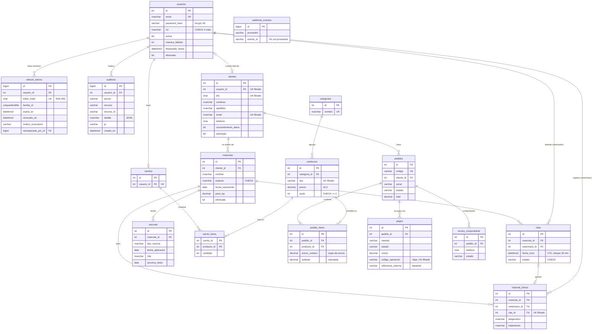

# Modelo de datos — RiverVet (4 sprints)

Base: **SQL Server** (`rivervet_db` en local, Azure SQL en producción). El esquema completo se crea con las migraciones de [`database/migraciones/`](../database/migraciones):

| Migración | Sprint | Tablas |
|---|---|---|
| `0001_esquema_inicial.sql` | 1 | usuarios, refresh_tokens, auditoria, clientes, mascotas |
| `0002_citas_historial_vacunas.sql` | 2 | citas, historial_clinico, vacunas |
| `0003_productos_ventas.sql` | 3 | categorias, productos, carritos, carrito_items, pedidos, pedido_items |
| `0004_pagos_notificaciones.sql` | 4 | pagos, webhook_eventos, envios_comprobante |

Las tablas de los sprints 2 a 4 ya existen, pero todavía no tienen endpoints. Si el modelo cambia, **se agrega una migración nueva**; nunca se edita una ya aplicada.

## Diagrama entidad-relación

## Restricciones que protegen el negocio

La base de datos es la **última línea de defensa**: aunque el código tuviera un error, estas reglas no se pueden romper.

| Restricción | Tabla | Qué impide |
|---|---|---|
| `UX_citas_veterinario_horario` (índice único filtrado) | citas | **Doble agendamiento**: dos citas vigentes del mismo veterinario a la misma hora (HU-008) |
| `UX_citas_mascota_horario` | citas | La misma mascota en dos citas simultáneas |
| `CK_citas_bloque` | citas | Citas fuera de los bloques de :00 y :30 |
| `CK_productos_stock` (`stock >= 0`) | productos | **Stock negativo** (HU-016) |
| `UX_pagos_yape_operacion` | pagos | Usar el mismo código de operación de Yape para dos pedidos |
| `UX_webhook_eventos_evento` | webhook_eventos | Procesar dos veces el mismo aviso de la pasarela |
| `UX_refresh_tokens_hash` | refresh_tokens | Tokens de sesión repetidos |
| `UX_clientes_dni` (filtrado por `eliminado = 0`) | clientes | Dos clientes activos con el mismo DNI |
| `CK_clientes_dni`, `CK_clientes_telefono` | clientes | DNI que no sea de 8 dígitos; celular que no sea de 9 dígitos empezando por 9 |
| `CK_vacunas_proxima_dosis` | vacunas | Próxima dosis anterior a la aplicación |
| `CK_auditoria_detalle_json` | auditoria | Detalle que no sea JSON válido |

Todas se probaron contra SQL Server real (ver el job `base-de-datos` de la CI y las pruebas de integración).

## Decisiones de diseño

- **Borrado lógico** (`eliminado BIT` + `eliminado_en`). El usuario de aplicación **no tiene permiso DELETE** (salvo en `carrito_items`), así que ni una inyección SQL podría borrar datos físicamente.
- **Fechas en UTC** (`SYSUTCDATETIME()`). Se convierten a `America/Lima` al mostrarlas. Las columnas `DATE` (nacimiento, vacunas) viajan como texto `AAAA-MM-DD` para evitar corrimientos de zona horaria.
- **Índices únicos filtrados** (`WHERE eliminado = 0`): un cliente dado de baja puede volver a registrarse con su DNI.
- **Dinero en `DECIMAL(10,2)`**, nunca `FLOAT`.
- **`pedido_items.precio_unitario`** copia el precio al momento de la venta. El precio se lee de `productos`, nunca del body.
- **Sin columnas de tarjeta**: ni número, ni CVV, ni vencimiento (alcance PCI DSS, ver `0004`).
- **Triage sin tabla**: por minimización de datos (Ley N° 29733), los síntomas consultados no se guardan.
- **Auditoría de solo-agregar** para la app (`DENY UPDATE, DELETE`).
